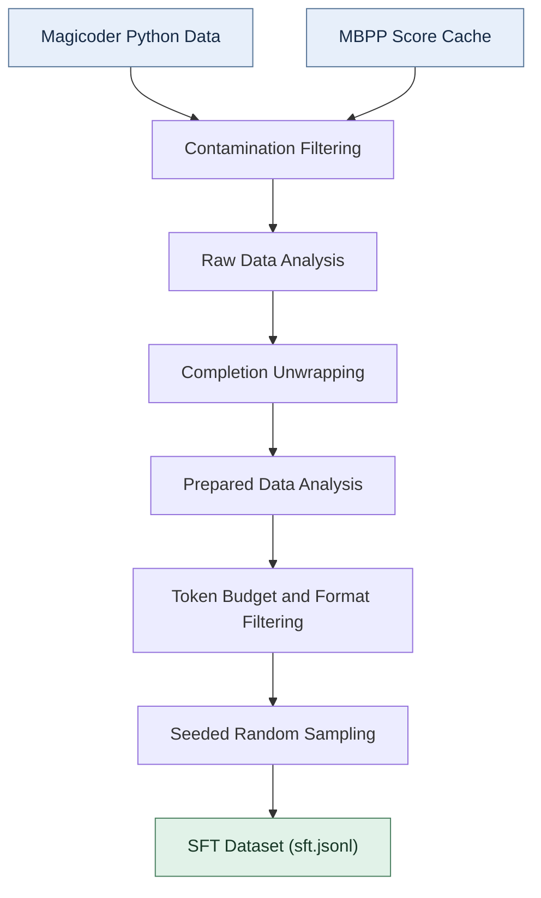

# Qwen2.5 Python SFT data preparation

Prepare Python instruction pairs from Magicoder-OSS-Instruct-75K for a Qwen2.5-1.5B-Instruct LoRA or QLoRA experiment. The pipeline reuses scored comparisons against MBPP test prompts, converts eligible completions to plain Python, and writes a reproducible sample.

## Run the pipeline

From the repository root, use the project's Python environment with `datasets` and `transformers`. The pinned Qwen tokenizer must be available in the local Hugging Face cache. Keep the repository's `score_cache/` directory available.

```bash
.venv/bin/python prepare_sft_data.py --token-budget 1024 --max-samples 5000 --seed 42 --html
```

The token budget applies to **one full prompt and completion after Qwen's chat template**. The defaults are 1,024 tokens, up to 5,000 examples, and seed 42. JSON logs and the final JSONL are always written. `--html` adds reports. Use `--no-notify-on-steps` to hide stage progress messages.

## Dataset filtering pipeline



- **Contamination.** The scorer normalizes text with Unicode NFKC, case folding, and whitespace normalization for exact matches. It compares the remaining prompts with MBPP using TF-IDF and GTE embeddings, retaining the highest cosine similarity per method. The preparation pipeline verifies Magicoder's ordered prompts against the cache and rejects rows at TF-IDF **0.45** or embedding **0.75** and above.
- **Completion preparation.** Unwrapping is limited to a single valid Python fence with no surrounding explanation and no detected prompt request for Markdown or explanation. Changed pairs are tokenized again. Completion checks verify Python syntax without running the code. Prompt requests are identified with English-language patterns, which can miss some wording.
- **Final selection.** The pipeline samples from the filtered pool after formatting and budget checks. In the recorded run, **38,284 Python rows → 38,105 after contamination filtering → 7,898 eligible → 5,000 selected**.

## Outputs

Each execution writes to `pipeline_runs/<UTC-timestamp>/`. [Browse the recorded run](pipeline_runs/20261125T111027.671691Z/pipeline.json).

| File | Contents |
| --- | --- |
| `pipeline.json` | Dataset and tokenizer revisions, stage timings, and relative output paths |
| `contamination.json` | Scoring hash, thresholds, counts, and retained source indices |
| `raw_analysis.json`, `prepared_analysis.json` | Row measurements and summary statistics before and after unwrapping |
| `filtered.json` | Filter criteria and every eligible row's measurements |
| `selection.json` | Seed, sample limit, counts, and selected source indices |
| `sft.jsonl` | Final conversational `prompt` and `completion` pairs |

With `--html`, the run also contains contamination, raw analysis, prepared analysis, filtering, and selection reports. The filtering report previews up to 100 rows. The recorded run includes a [selection report](pipeline_runs/20261125T111027.671691Z/selection.html) and the [final dataset](pipeline_runs/20261125T111027.671691Z/sft.jsonl).

## Score cache

[`get_or_create_scores()`](contamination_scorer.py) computes scores when the cache has no matching entry. Each `score_cache/<scoring_hash>/` entry stores `config.json` and `scores.json`. The key includes the ordered input prompts, TF-IDF settings, scoring version, and embedding configuration. Thresholds, sample size, and seed can change while reusing the same scores.

When creating an embedding cache entry, supply the model ID, full revision, and effective encoder settings. Dataset metadata is recorded for provenance. The preparation pipeline uses its configured scoring hash and the Magicoder revision recorded there. The cache's optional HTML report shows the top 100 prompt pairs per similarity method.

## LoRA memory profiling

Run from the repository root with CUDA-enabled PyTorch, `trl`, `peft`, and the pinned Qwen model and tokenizer in the local Hugging Face cache. On Ubuntu or WSL, install the development headers for your Python version if Triton reports a missing `Python.h`.

```bash
.venv/bin/python profile_training_memory.py --batch-size 4 --max-length 1024 --lora-rank 8
```

The profiler selects the longest examples by token count after applying Qwen's chat template and runs one BF16 LoRA optimizer step with adapters on `q_proj` and `v_proj`. The defaults are batch size 1, a 1,024-token training limit per example, and rank 8. Use `--dataset-path` to choose a different JSONL file.

Each run writes `memory_profile.json` and `memory_profile.html` to `memory_profile_runs/<UTC-timestamp>/`. The report includes the first forward's token count, trainable parameter counts, and CUDA memory measurements through the first optimizer step. The recorded batch-size-4 run used 3.775 GiB of peak allocated memory. [Recorded profile](memory_profile_runs/20261126T175635.330835Z/memory_profile.html)

## License

This repository's original code and documentation are licensed under the [MIT License](LICENSE). Third-party data and models retain their upstream licenses.

## Acknowledgments

- **Magicoder-OSS-Instruct-75K** by the iSE research group supplies the training examples. The included SFT data is a filtered and sampled Python subset with eligible completion code fences removed. [Dataset card and MIT license information](https://huggingface.co/datasets/ise-uiuc/Magicoder-OSS-Instruct-75K)
- **Mostly Basic Python Problems (MBPP)** by Google Research supplies reference prompts for contamination filtering and tasks for evaluation. The score reports reproduce selected reference prompts. [Dataset card](https://huggingface.co/datasets/google-research-datasets/mbpp) · [CC BY 4.0](https://creativecommons.org/licenses/by/4.0/)
- **Qwen2.5-1.5B-Instruct** by the Qwen team supplies the base model and tokenizer. [Model card and Apache-2.0 license information](https://huggingface.co/Qwen/Qwen2.5-1.5B-Instruct)
- **GTE ModernBERT Base** by Alibaba's Tongyi Lab supplies embeddings for semantic overlap detection. [Model card and Apache-2.0 license information](https://huggingface.co/Alibaba-NLP/gte-modernbert-base)
